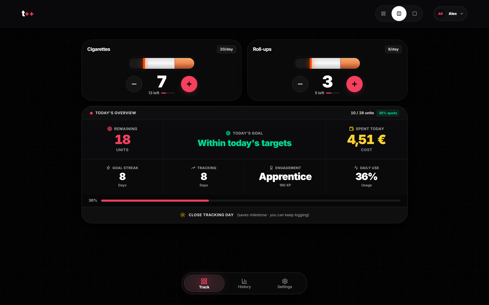
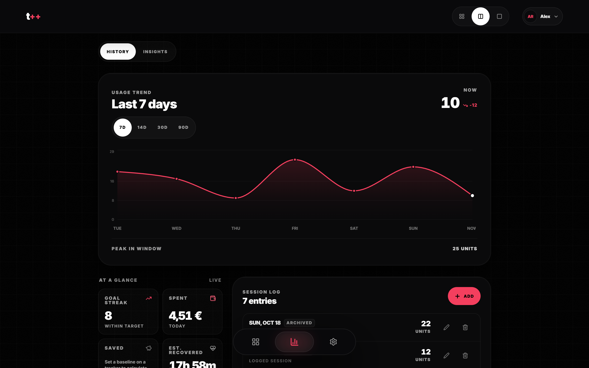
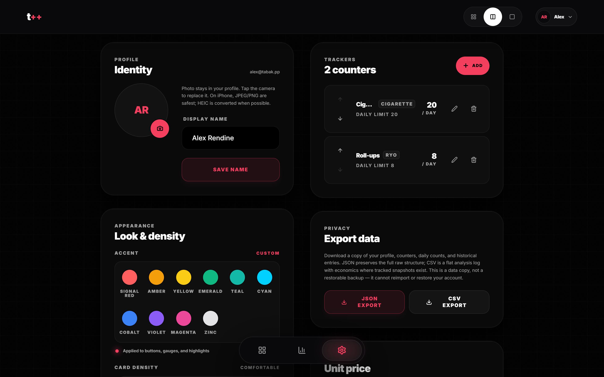
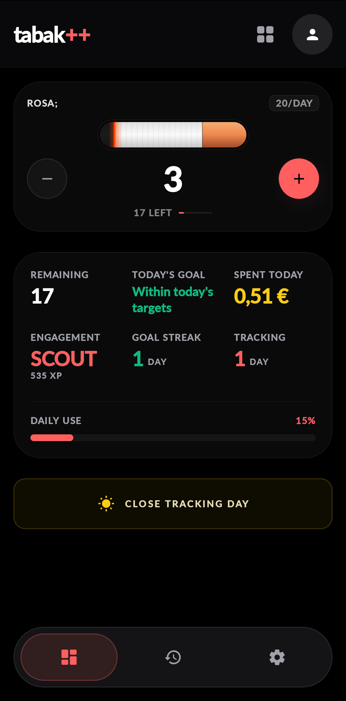
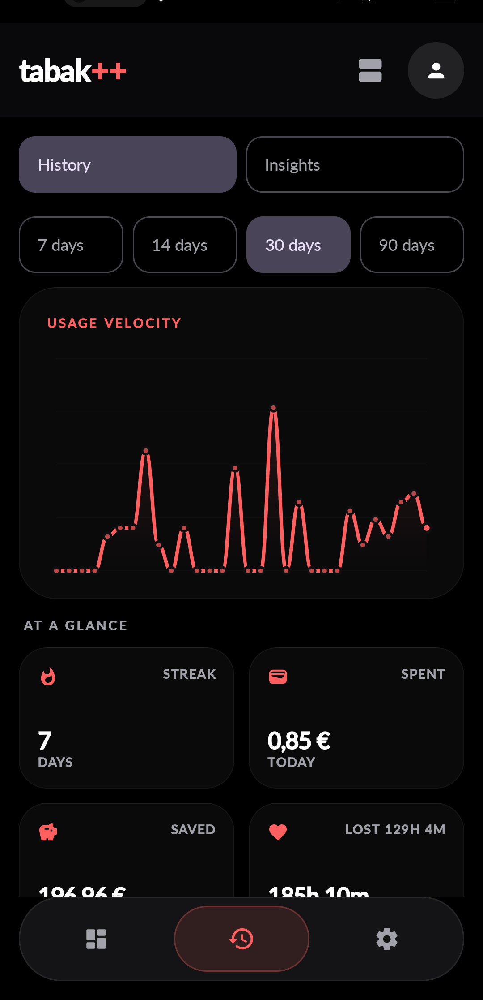
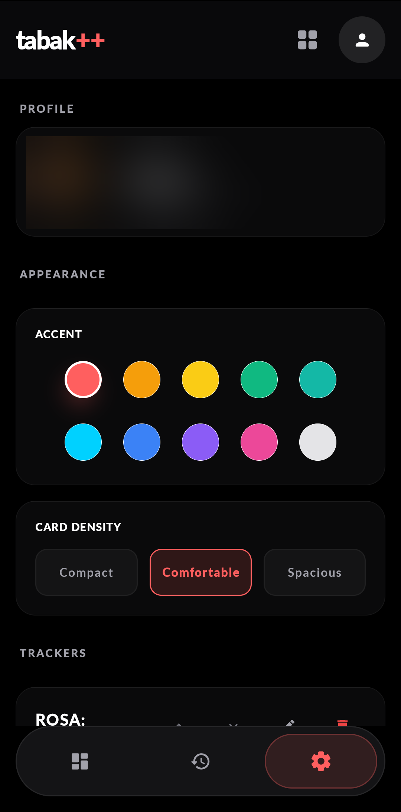
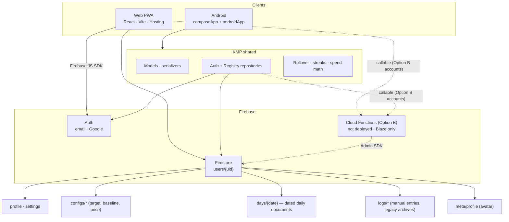
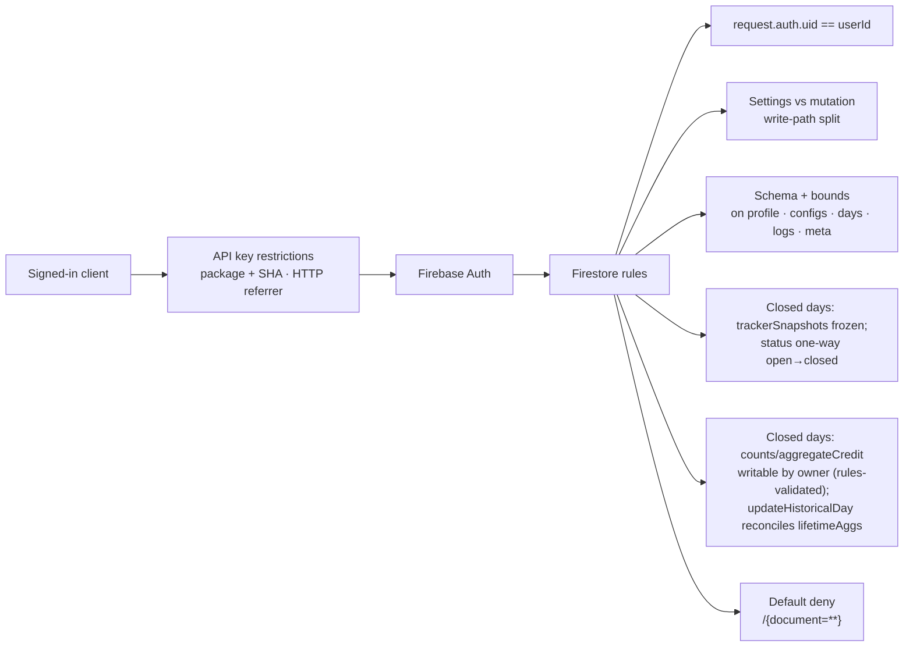

<h1 align="center">tabak++</h1>

<p align="center">
  A private, cross-platform tobacco-use tracker built around the numbers that matter today:<br/>
  <strong>how many, how much left, how much spent, and whether you're still on streak.</strong>
</p>

<p align="center">
  <a href="https://tabakpp.web.app"><strong>Open the web app</strong></a>
  ·
  <a href="https://github.com/shareef01/tabakpp/releases/latest"><strong>Download the Android APK</strong></a>
  ·
  <a href="SETUP_GUIDE.md">Setup</a>
  ·
  <a href="PRIVACY.md">Privacy</a>
  ·
  <a href="SECURITY.md">Security</a>
</p>

<p align="center">
  <a href="https://github.com/shareef01/tabakpp/actions/workflows/ci.yml?query=branch%3Amain"></a>
  <a href="https://github.com/shareef01/tabakpp/actions/workflows/android-integration.yml?query=branch%3Amain"></a>
  <a href="LICENSE"></a>
</p>

<p align="center">
  
</p>

---

**Contents:** [Features](#features) · [Screenshots](#screenshots) · [Design principles](#design-principles) · [Stack](#stack) · [Data model](#data-model) · [Security & privacy](#security--privacy) · [Getting started](#getting-started) · [Testing](#testing) · [Known limitations](#known-limitations)

## Features

Most quit apps bury you in tips. **tabak++** stays on today's numbers.

- **One-tap logging** with undo, and a gauge per tracker that burns down as you use your daily allowance
- **Daily limits that always land on the right day**, even if the app was closed over midnight (see [Data model](#data-model))
- **Spend, savings and streaks at a glance.** Life-expectancy figures are population-level estimates and are labeled that way, not presented as personal facts.
- **Optional baseline tracking**, so reduction and money saved are measured against your own history, not against today's target
- **Editable history** with backfill for days you forgot to log
- **Realtime sync** between the web PWA and the Android app
- **Bookmarkable routes** (`/track`, `/history`, `/settings`), accent colors and layout density you can tune

## Screenshots

<table>
  <tr>
    <th>Web: History</th>
    <th>Web: Settings</th>
  </tr>
  <tr>
    <td></td>
    <td></td>
  </tr>
</table>

<p align="center">
  
  &nbsp;
  
  &nbsp;
  
  <br/>
  <sub>Android: Track · History · Settings</sub>
</p>

## Design principles

- **One product, two clients.** An installable web PWA and a native Android app
  share one Firebase backend, so counters stay in sync across devices in realtime.
- **Dated counts, not ambient counters.** Every count belongs to an explicit
  tracking date decided when it is written, so a rollover is never lost because
  the app was closed or a timer didn't fire.
- **History you can't silently rewrite.** Once a day is closed, its stamped
  tracker snapshot is frozen by Firestore rules. Repricing a tracker today can
  never rewrite what an old day cost.
- **Baseline ≠ target.** Money saved and reduction are measured against an
  optional personal baseline, never against a goal, because those are different claims.
- **Owner-only by construction.** Firestore Security Rules are the primary
  authorization boundary: default-deny, scoped to `users/{uid}`.
- **Spark today, server-authoritative money parked (Option B).** Production runs
  on the Firebase Spark plan with direct client writes (`LEGACY` accounts). A
  trusted Cloud Functions boundary (`executeFinancialOperation`, `migrateAccount`,
  `deleteAccountData`) lives in [`functions/`](functions/) but is **not deployed**:
  it needs Blaze. When enabled, it reconciles financial state atomically on the
  server across the four canonical ledger metrics (`saved`, `wasted`,
  `baselineSaved`, `smokingUnits`), with strict count ownership to prevent double
  counting. The code is kept and tested in CI against the emulators.

## Stack

Two clients, one backend. Shared domain logic on Android lives in a Kotlin Multiplatform module; the web app mirrors the same product surface in React.

| Layer | Tech |
|---|---|
| **Android** | Kotlin 2.4 · Jetpack Compose (Compose Multiplatform UI) · GitLive Firebase |
| **Web** | React 19 · Vite 8 · Tailwind CSS 4 · Firebase JS SDK · installable PWA |
| **Backend** | Firebase Spark plan: Auth (email + Google) · Cloud Firestore · Hosting. Cloud Functions (Option B) written and tested, not deployed. App Check not used |
| **Shared (KMP)** | Models, serializers, repositories, day-rollover / streak / spend math |
| **Build** | Gradle 9.8 · AGP 9.4 · Java 17 bytecode · minSdk 26 · targetSdk 36 · compileSdk 37 |
| **Toolchain** | Node 24.21.0 ([`.nvmrc`](.nvmrc)) · npm 10.9.8 (`packageManager`) |

Realtime listeners keep Track / History / Settings in sync across devices. Firestore rules gate reads and writes to the signed-in owner.

### Architecture



### Data model

Every count belongs to an explicit tracking date, decided at the moment it's
written — never to a mutable "current session" bucket that could survive
across a rollover if the app was closed, a timer didn't fire, or "close day"
was never pressed.

```
users/{uid}                        profile + settings + lifetime rollup (rare writes)
users/{uid}/configs/{id}           trackers — target, optional baseline, price
users/{uid}/days/{YYYY-MM-DD}      counts + a stamped historical snapshot per
                                    tracker (name/target/baseline/price as of
                                    that day) + that day's financial credit.
                                    Closing a day only marks it complete and
                                    folds its credit into the profile rollup —
                                    it never decides which date a count
                                    belongs to.
users/{uid}/logs/{id}              legacy ledger: manual backfill entries,
                                    and pre-migration day archives
users/{uid}/meta/profile           avatar — kept off the profile document so
                                    a large, rarely-changing blob never rides
                                    along on every counter tap
```

What the rules guarantee once a day is closed (see `validDayUpdate` in
[`firestore.rules`](firestore.rules)):

- **Frozen snapshot.** Any write that would change a closed day's stamped
  `trackerSnapshots` is rejected. Changing a tracker's target today can never
  retroactively change whether an old day was a success, and repricing a tracker
  can never rewrite what an old day cost.
- **Locked identity.** `status`, `date`, `foldedIntoLifetime` and
  `legacyMigrationApplied` are one-way or identity-locked.
- **Still editable by the owner.** `counts` and `aggregateCredit` stay writable
  by the authenticated owner. The rules validate shape and bounds, but they do
  not force writes through the application-layer `updateHistoricalDay` path.
  That path also reconciles `lifetimeAggregates` on the profile by the delta, so
  a direct Firestore write can bypass that reconciliation.
- **Taps still count after closing.** Closing a day (with "Close Tracking Day",
  or automatically by another device whose clock or time zone is ahead) does not
  stop logging it. A +/− on a closed day updates its `counts` and
  `aggregateCredit` from the frozen snapshot and moves `lifetimeAggregates` by
  the same delta. A tracker with no snapshot that day can't be added this way,
  because the snapshot is frozen; log it with a manual entry in History instead.
  This applies to the current Spark (`LEGACY`) path; the undeployed Option B
  callable still rejects closed days.

Money saved and reduction are always computed against a tracker's **baseline**
(an optional, separate "previous average" field), never against its target.
Hitting a goal and reducing from a personal baseline are different claims and
are never conflated.

Accounts created before this schema keep working: a one-time, idempotent
migration folds any leftover live counter state into the correct dated
document (using the same day-start-hour rule "End day" always used), and
moves the avatar out of the profile document, the first time an updated
client opens the account.

## Security & privacy

See [SECURITY.md](SECURITY.md) for the full threat model and
[PRIVACY.md](PRIVACY.md) for data handling and retention.



In short:

- Access is owner-only under `users/{uid}`, and everything else is denied by default.
- Settings updates cannot touch counters, and counter/archive writes cannot touch identity or pricing.
- A closed `days/{date}` document's `trackerSnapshots` can never be rewritten. Its `counts` and
  `aggregateCredit` remain owner-writable within rule-validated shape and bounds (see [Data model](#data-model)).
- Every write path is covered by rules tests that run against the real Firestore emulator in CI.

On Spark, increments are written directly by the client and no server re-checks them,
so Firestore Security Rules are the primary boundary protecting cross-user isolation.
A determined owner can still edit their own numbers. Stats are for self-tracking,
not an audit trail.

Engineering controls behind those claims:

- **Immutable CI action pins** — every third-party GitHub Action is pinned to a
  full 40-character commit SHA, enforced in CI by
  [`.github/scripts/validate-action-pins.py`](.github/scripts/validate-action-pins.py).
- **Reproducible installs** — CI installs with `npm ci` against a committed
  lockfile, plus a dedicated lockfile-integrity check.
- **Dependency auditing** — `npm run audit:prod` fails the build on any HIGH or
  CRITICAL production advisory.
- **Emulator-backed rule testing** — Firestore rules are tested against a real
  Firestore emulator in CI, not mocked.

**On App Check (not used):** this project runs without Firebase App Check — no attestation provider, no token, and no enforcement on either client. That is a deliberate scope decision, not an oversight: the app is a single-user self-tracking tool on the Spark plan, and the authorization boundary is carried by **Firestore Security Rules** plus defense-in-depth **API key restrictions** (package + signing certificate on Android, HTTP referrer on web).

The trade is explicit: without attestation, a modified client can still talk to Firestore as its own signed-in user (never as another user), and abuse resistance rests on API-key restrictions rather than on attestation. App Check can be added later as a separate, opt-in change — it would require registering the web reCAPTCHA Enterprise and Android Play Integrity providers, registering the production signing SHA-256, and observing verified-traffic metrics *before* enforcement; see [SETUP_GUIDE.md](SETUP_GUIDE.md) → "Adding App Check later (not currently used)". Until then there is nothing to enforce and nothing to misconfigure.

## Platforms

| Platform | Status |
|---|---|
| **Android** | Native app (Kotlin · Compose Multiplatform) — install the latest APK from [GitHub Releases](https://github.com/shareef01/tabakpp/releases/latest) |
| **Web** | Installable PWA at [tabakpp.web.app](https://tabakpp.web.app) |
| **iOS** | Not a release target. The Compose shell is present but shows an explicit unsupported gate (see [SETUP_GUIDE.md](SETUP_GUIDE.md)) |

## Getting started

Full Firebase, signing, and security-boundary notes: **[SETUP_GUIDE.md](SETUP_GUIDE.md)**

### Prerequisites

| For | You need |
|---|---|
| **Web** | Node **24.21.0** ([`.nvmrc`](.nvmrc)) and npm **10.9.8** (pinned via `packageManager`) |
| **Android** | JDK 17+ and Android Studio, plus `google-services.json` (see [SETUP_GUIDE.md](SETUP_GUIDE.md)) |
| **Firebase tooling** | [Firebase CLI](https://firebase.google.com/docs/cli) — only needed for the local Firestore emulator / rules tests |

### Web

```bash
cd webApp
npm ci          # reproducible install from the committed lockfile
npm run dev     # Vite dev server
```

Copy `webApp/.env.example` to `webApp/.env.local` and fill in your Firebase web
app config before the app will render.

```bash
npm run build        # production build -> webApp/dist
npm run lint         # ESLint
npm run audit:prod   # production dependency audit (fails on HIGH/CRITICAL)
```

### Android

Open the repository in Android Studio and run the `androidApp` configuration after
adding `google-services.json`, or install a signed APK from
[GitHub Releases](https://github.com/shareef01/tabakpp/releases/latest).

```bash
./gradlew :androidApp:assembleDebug
```

## Testing

| Suite | Command | Protects |
|---|---|---|
| Unit + coverage | `npm run coverage` | Web app behavior and domain math |
| Cross-platform contract | `npm run test:contract` | Semantic parity between the JS and Kotlin ports of the domain math |
| Firestore rules | `npm run test:rules` | Real authorization rules, executed against the Firestore emulator |
| PWA offline + freshness | `npm run test:pwa` (after `npm run build`) | Offline navigation and deploy freshness of the production build |
| Accessibility | `npm run test:a11y` | axe-core over 4 viewports × 4 views, per-accent contrast, and 200% zoom reflow — exits non-zero on any violation |
| Kotlin unit | `./gradlew :shared:testDebugUnitTest :composeApp:testDebugUnitTest` | KMP domain math, repositories, view models, Compose UI (includes the Kotlin side of the contract fixtures) |
| Android app unit | `./gradlew :androidApp:testDebugUnitTest` | No local unit tests today: the only one was the App Check provider-selection guard, removed together with App Check (the Gradle task is a no-op in CI). App-level behaviour is covered by the `:shared`/`:composeApp` unit suites and the Android instrumentation suite |
| Cloud Functions | `cd functions && npm test` | Option B financial math and input validation |
| Functions integration | see the `functions` job in [`ci.yml`](.github/workflows/ci.yml) | Option B callables end-to-end against the Auth/Firestore/Functions emulators |
| Android instrumentation | `./gradlew :androidApp:connectedDebugAndroidTest` | Android/KMP behavior against a real emulator |

The `npm run …` commands run from `webApp/`.

The contract fixtures in [`shared-tests/`](shared-tests/) are the important one:
the JS and Kotlin domain implementations are hand-mirrored rather than code-shared,
so a shared set of semantic vectors is what catches drift between them. See
[shared-tests/README.md](shared-tests/README.md).

The rules suite boots a local Firestore emulator, so no live Firebase project is
needed (`cd webApp && npm run test:rules`; requires the Firebase CLI).

Android instrumentation runs in CI for every pull request and every push to
`main`, and preserves emulator logs, logcat, and per-run test metadata as a
downloadable artifact for each attempt — including failed ones.

## Known limitations

- **Logging needs a network connection** on both the web app and Android: counts are
  written in Firestore transactions, which do not queue offline. The PWA shell still
  opens offline.
- **Up to 8 trackers** at once.
- **Amounts are shown in euros.** There is no currency setting.
- **Totals are client-computed and owner-editable.** On the Firebase Spark plan the
  rules validate shape and ownership but cannot recompute spend/savings aggregates,
  so an account owner can rewrite their own totals. The Option B Cloud Functions in
  `functions/` move this to a trusted server but are not deployed.

## Repository structure

```
tabakpp/
├── webApp/            React 19 PWA (Vite, Tailwind, Vitest, Firebase JS SDK)
├── shared/            Kotlin Multiplatform: models, serializers, repositories
├── composeApp/        Compose Multiplatform UI shared across targets
├── androidApp/        Android application module
├── iosApp/            iOS shell — intentionally a non-release "unsupported" gate
├── functions/         Option B Cloud Functions (written and CI-tested, not deployed)
├── shared-tests/      Cross-platform domain contract fixtures (JS ⇄ Kotlin)
├── docs/              Financial semantics, migration/recovery, release-hardening notes
├── assets/screenshots/ README showcase images and per-theme captures
├── scripts/           Android screenshot capture, showcase builder, staging migration CLI (web: webApp/scripts)
├── .github/           Workflows, CI guard scripts, release notes
│   ├── workflows/     ci.yml · android-integration.yml · release-android.yml
│   └── scripts/       action-pin, lockfile and release-safety validators (+ self-tests)
├── firestore.rules    Authorization + validation (the primary security boundary)
├── firebase.json      Rules, hosting, emulator and functions config (run firebase from the repo root)
└── build.gradle.kts · settings.gradle.kts · gradle/libs.versions.toml
```

## Development notes

**Firestore gRPC dependency override.** `webApp/package.json` carries a scoped
npm override pinning the Node-only `@grpc/grpc-js` dependency of
`@firebase/firestore` to a patched release, because released Firestore currently
declares a range that cannot reach one. It keeps the production dependency audit
green. Remove it once a released `@firebase/firestore` range resolves to a
non-vulnerable gRPC release without an override — upstream tracking lives at
[firebase/firebase-js-sdk#10400](https://github.com/firebase/firebase-js-sdk/issues/10400).

**Node and npm are pinned, not merely recommended.** `.nvmrc` and the
`packageManager` field exist so local runs and CI resolve the same dependency
tree; changing either will produce a lockfile diff.

## Contributing

External contributions are welcome through pull requests. For anything touching
security rules, data-model semantics, or CI, please open an issue first so the
approach can be discussed — those areas carry invariants that are easy to break
silently.

Read **[CONTRIBUTING.md](CONTRIBUTING.md)** before your first PR: it lists the
eight invariants a change must not break, the exact commands to run, and why the
`react-hooks/exhaustive-deps` warnings in `npm run lint` are intentional.

By contributing you agree that your work is licensed under the [MIT License](LICENSE).

## License

[MIT](LICENSE) © 2026 shareef01

## Author

Created and maintained by [@shareef01](https://github.com/shareef01).
