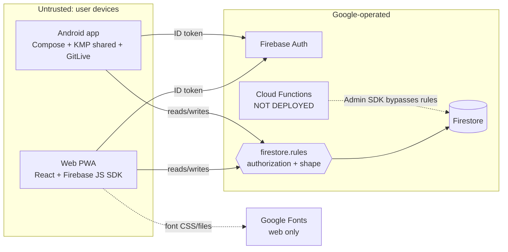

# 01 — Repository inventory

| Item | Value |
|---|---|
| Repository | https://github.com/shareef01/tabakpp (`origin`) |
| Branch | `main` |
| Commit | `ec8bdf799c5ce2987b7cdff8301caf66954a6126` (2026-11-10, merge of PR #161) |
| Audit date | 2026-11-12 |
| Working tree | Clean at start. The audit adds only `docs/audit-2026-11-12/`; one temporary probe test was created and removed (copy kept outside the repo). |
| Tracked files | 329 (`git ls-files`) |
| Release in tree | `v1.0.14` (`.github/release-notes/`) |

## Languages, frameworks, tooling

| Area | Stack (from manifests, not README) |
|---|---|
| Web/PWA (`webApp/`) | JavaScript (JSX, no TypeScript), React 19.3, Vite 8.3, Tailwind 4.3, Firebase JS SDK 13.1, framer-motion, recharts, vite-plugin-pwa 2 (Workbox `generateSW`), heic2any (lazy) |
| Shared domain (`shared/`) | Kotlin Multiplatform 2.4.21 (android + iOS targets), GitLive Firebase 2.7.0, Koin, kotlinx-datetime |
| UI (`composeApp/`) | Compose Multiplatform |
| Android host (`androidApp/`) | AGP 9.5.0, compileSdk 37, targetSdk 36, minSdk 26, R8 minify on release |
| iOS (`iosApp/`) | Two Swift stub files; intentionally not a release target |
| Backend | Firestore + Firebase Auth (Spark plan). Cloud Functions in `functions/` (Node 24, firebase-functions 7.4, firebase-admin 14.5) are **not deployed** (predeploy guard `scripts/guard-functions-deploy.mjs`) |
| Package managers / lockfiles | npm 10.9.8 (`webApp/package-lock.json`, `functions/package-lock.json`); Gradle 9.8.2 wrapper with version catalog `gradle/libs.versions.toml` (no Gradle dependency lockfile for modules; `settings-gradle.lockfile` is gitignored) |
| Tests | Vitest 5 (web unit, rules, emulator), `@firebase/rules-unit-testing` 6, `node --test` (functions), JUnit/Robolectric (Kotlin JVM), Android instrumentation (`androidTest`), Puppeteer-core PWA harness, axe-core a11y harness, Python gate scripts |
| CI/CD | `.github/workflows/ci.yml` (5 jobs), `android-integration.yml` (emulator instrumentation), `release-android.yml` (manual dispatch, `release` environment) |
| Deploy config | `firebase.json` (hosting `webApp/dist`, rules, functions block for emulators), `firebase.staging*.json`, `.firebaserc` |

## Entry points and key modules

| Concern | Location |
|---|---|
| Web entry | `webApp/src/main.jsx` → `App.jsx` (lazy screens) |
| Web state | `webApp/src/hooks/useRegistry.js` (listeners, optimistic counter overlay, mutations) |
| Web data layer | `webApp/src/services/registryService.js` (all Firestore reads/writes) |
| Web auth | `webApp/src/context/AuthContext.jsx`, `components/auth/AuthScreen.jsx`, `utils/deleteAuthUserAfterWipe.js` |
| Firebase init | `webApp/src/firebase.js` (web), GitLive in `shared/.../di/Koin.kt` (Android) |
| JS domain math | `webApp/src/utils/smokingCalculator.js` (port of Kotlin), `services/financialReadModel.js`, `utils/ExportBuilder.js` |
| Kotlin domain math | `shared/src/commonMain/kotlin/com/tabakpp/app/domain/SmokingCalculator.kt`, `RegistryMutations.kt`, `FinancialReadModel.kt`, `ExportBuilder.kt` |
| Kotlin data layer | `shared/.../data/FirebaseRegistryRepository.kt` (1523 lines), `FirebaseAuthRepository.kt`, `InputSanitizer.kt` |
| Kotlin state | `shared/.../viewmodels/RegistryViewModel.kt`, `AuthViewModel.kt` |
| Rules | `firestore.rules` (835 lines) |
| Trusted backend (undeployed) | `functions/index.js` (`executeFinancialOperation`, `migrateAccount`, `deleteAccountData`), `financial.js`, `validation.js` |
| Migration utilities | `migrateSmokingUnitsIfNeeded`, `migrateLegacyActiveCounts`, `migrateAvatarToProfileMeta` (both clients); `scripts/migrate-staging.mjs` |
| Account deletion | `RegistryService.deleteAllUserData` / `FirebaseRegistryRepository.deleteAllUserData` + Auth deletion; `functions/index.js` `deleteAccountData` for locked accounts |
| Contract fixtures | `shared-tests/domain-fixtures.json`, consumed by `webApp/src/utils/domainFixtures.contract.test.js` and `shared/src/androidUnitTest/.../DomainContractFixturesTest.kt` |
| Release scripts | `.github/scripts/*.py` (pin validation, lockfile validation, release-tag resolution, exact-SHA CI check, instrumentation-results gate) |

## Firestore data model (as enforced by rules)

```
users/{uid}                         profile, settings, lifetimeAggregates, financialMode, deleting tombstone
  configs/{id}                      trackers (≤ 8 enforced by clients only)
  days/{YYYY-MM-DD}                 dated counts + trackerSnapshots + aggregateCredit + status/foldedIntoLifetime
  logs/{id}                         manual entries, legacy archives, LEGACY_RECOVERY rows
  meta/profile, meta/legacy_*       avatar; legacy-migration idempotency markers
  dailyFinancials/{date}            Option B ledger (client-writable only while LEGACY)
  financialOperations/{id}          LEGACY client receipts (immutable)
  trustedOperations|trustedDeletedLogs|trustedRateLimits   server-only, client read/write denied
```

## Architecture and trust boundaries



- **Boundary 1 — client ↔ rules.** Every production write passes `firestore.rules`. The rules decide ownership (`isOwner`), document shape and some one-way state transitions. They do not recompute money.
- **Boundary 2 — rules ↔ Admin SDK.** It exists only if the Functions are deployed. They currently aren't, so production has no server-side computation at all.
- **No App Check.** A modified client can do anything the rules allow for its own `uid`, and nothing for any other `uid`.
- **Shared logic is duplicated, not shared at runtime.** The Kotlin and JS calculators are separate implementations held together by contract fixtures.
